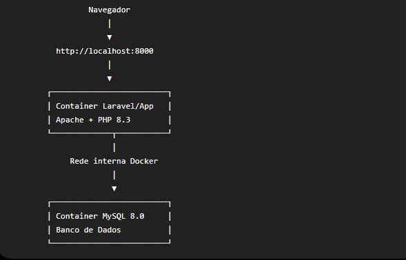
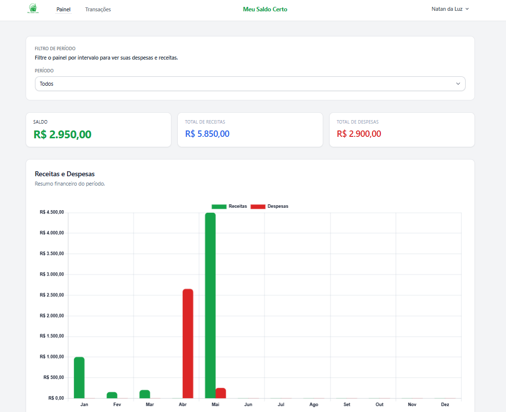
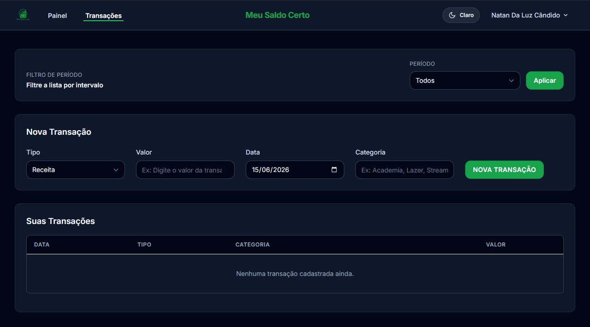
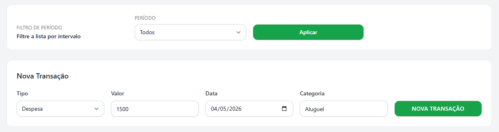
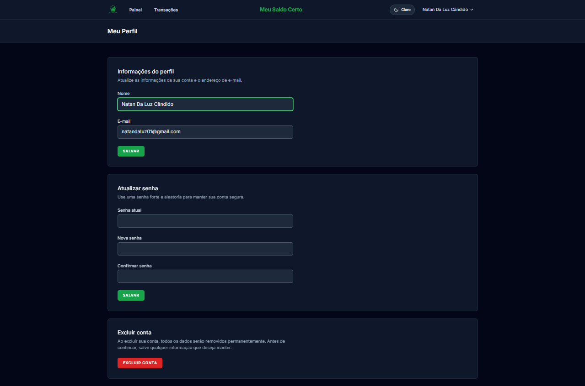

## MEU SALDO CERTO

Web system for personal financial management developed with Laravel, allowing users to manage income, expenses, categories, and financial activity through a dashboard with charts, along with new features as the project continues to evolve and receive updates.

<p align="center">
  A financial system for managing income, expenses, categories, and balance for authenticated users — simple, practical, and fast, with no unnecessary complexity!
</p>

<p align="center">
  
  
  
  
</p>

## About the Project

**Meu Saldo Certo** is a web application for personal financial management. The system allows users to record financial transactions, classify income and expenses by category, track the current balance, and view consolidated data on a dashboard. The project was developed as a professional portfolio application, focusing on code organization, proper use of Laravel resources, separation of responsibilities, and preparation for execution in a Docker environment.

## Project Features

- User registration and authentication with Laravel Breeze.
- Login and logout.
- Financial dashboard.
- Display of income, expenses, and current balance.
- Financial charts using Chart.js.
- Income CRUD.
- Expense CRUD.
- Category registration associated with transactions.
- Date-range filters.
- Pagination.
- Validation with Form Requests.
- Authorization with Policies.
- Data separation by authenticated user.
- Relational database modeling.

## Stack Used in Meu Saldo Certo

- PHP
- Laravel
- MySQL
- Docker & Docker Compose
- Apache
- Composer
- Node.js
- Vite
- Blade
- Tailwind CSS
- JavaScript
- Chart.js

## Project Architecture

The project uses Laravel's own MVC architecture, separating responsibilities among routes, controllers, models, views, requests, policies, and migrations.



## Technical Project Organization

- `app/Http/Controllers`: controllers responsible for web flows.
- `app/Http/Requests`: centralized validation with Form Requests.
- `app/Models`: main application entities.
- `app/Policies`: user authorization rules.
- `database/migrations`: relational database structure.
- `resources/views`: application Blade screens.
- `resources/js` and `resources/css`: assets compiled by Vite.
- `routes/web.php`: definition of web routes protected by authentication.

## Project Prerequisites

- Docker
- Docker Compose
- Git

## 1. Clone the Project

```bash
git clone https://github.com/NatanLuz/meu-saldo-certo.git
cd meu-saldo-certo
```

## 2. Configure the `.env` File

Copy the example file:

```bash
cp .env.example .env
```

Windows PowerShell:

```powershell
Copy-Item .env.example .env
```

To run with Docker Compose, configure the database using the MySQL service name:

```env
DB_CONNECTION=mysql
DB_HOST=mysql
DB_PORT=3306
DB_DATABASE=meu_saldo_certo
DB_USERNAME=meu_saldo_certo
DB_PASSWORD=secret
```

It is also recommended to keep:

```env
SESSION_DRIVER=database
CACHE_STORE=database
QUEUE_CONNECTION=database
```

### 3. Start the Containers

```bash
docker compose up -d --build
```

The command creates and starts:

- Laravel + Apache + PHP container;
- MySQL 8 container;
- persistent volume for the database;
- internal network for communication between the application and database.

### 4. Run the Project Migrations

```bash
docker compose exec app php artisan migrate
```

### 5. Create the Storage Link, if necessary

```bash
docker compose exec app php artisan storage:link
```

### 6. Create the Initial User

Registration can be completed through the application screen by accessing the link.

If it is necessary to create a test user through the terminal, the project provides the following command:

```bash
docker compose exec app php artisan make:test-user
```

### 7. Access the Application

```text
http://localhost:8000
```

## Environment Variables

Main variables used to connect to MySQL:

```env
DB_CONNECTION=mysql
DB_HOST=mysql
DB_PORT=3306
DB_DATABASE=meu_saldo_certo
DB_USERNAME=meu_saldo_certo
DB_PASSWORD=secret
```

Description:

- `DB_CONNECTION`: database driver used by Laravel.
- `DB_HOST`: database host. In Docker Compose, it must be the `mysql` service name.
- `DB_PORT`: internal MySQL port in the container.
- `DB_DATABASE`: application database name.
- `DB_USERNAME`: user used by the application.
- `DB_PASSWORD`: application user's password.

In production, these values should be defined by the hosting provider without committing real credentials to the repository.

# Security and Best Practices

- Authentication implemented with Laravel Breeze.
- Main routes protected by authentication.
- Centralized input validation with Form Requests.
- Policies used to authorize access to transactions.
- Data separation by authenticated user.
- Environment variables used for sensitive configuration.
- Passwords stored using Laravel's default hashing mechanism.
- Blade views with automatic output escaping.
- Relational database with foreign keys and versioned migrations.
- Docker environment separated into application and database containers.

## Tests

The project is prepared for automated testing with PHPUnit.

To run the test suite:

```bash
php artisan test
```

In a Docker environment:

```bash
docker compose exec app php artisan test
```

## Screenshots

## Login


## Dashboard



## Transactions



## New Transaction



## Profile



## Project Architecture


## Current Version

**v1.1.0**

Changes in this version:

- Complete Dockerization.
- Docker Compose configuration.
- Containerized MySQL.
- Preparation for a production environment.
- Improvements to the Laravel configuration for MySQL use.

## Deployment

Link: https://meu-saldo-certo-9o9r.onrender.com

## 👤 Author

**Natan Da Luz**

- LinkedIn: [linkedin.com/in/natandaluz](https://www.linkedin.com/in/natandaluz/)
- Portfolio: [portfolionatan.vercel.app](https://portfolionatan.vercel.app/)
- E-mail: [natandaluz01@gmail.com](mailto:natandaluz01@gmail.com)
