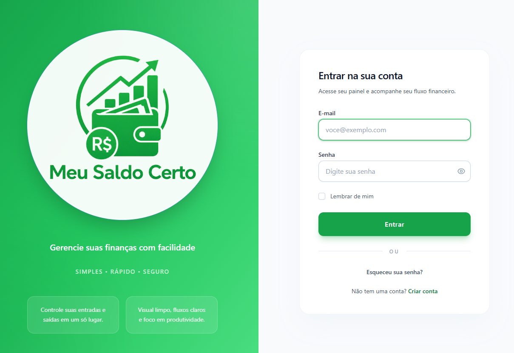

# Meu Saldo Certo

**Meu Saldo Certo** is a personal finance web application for tracking income and expenses, checking your balance, and reviewing financial activity over time.


## Features

- Account registration, login, password recovery, and profile management.
- Create, edit, and delete income and expense transactions with a date, amount, and category.
- Browse transactions with period filters and pagination.
- View your balance, income and expense totals, and a comparison chart on the dashboard.
- Filter by the last 7 days, last 30 days, current month, or full history; the dashboard also supports a custom date range.
- User-specific data and authorization that prevents changes to other users' transactions.
- Responsive interface with light and dark themes.

## Technologies

- PHP 8.2+ and Laravel 12
- MySQL 8
- Blade, Tailwind CSS, Alpine.js, and Vite
- Chart.js for the financial chart
- Docker and Docker Compose
- PHPUnit for testing

## Getting started with Docker

### Prerequisites

- Git
- Docker and Docker Compose

Clone the repository and navigate to the project directory. Then create the environment file:

```bash
cp .env.example .env
```

In PowerShell, use `Copy-Item .env.example .env` instead. For local HTTP access, update the following values in `.env`:

```dotenv
APP_ENV=local
APP_DEBUG=true
APP_URL=http://localhost:8000
SESSION_SECURE_COOKIE=false
```

Generate an application key:

```bash
docker compose run --rm --no-deps --entrypoint php app artisan key:generate --show
```

Copy the displayed value, including the `base64:` prefix, into `APP_KEY` in `.env`. Then start the services:

```bash
docker compose up -d --build
```

The application will be available at [http://localhost:8000](http://localhost:8000). Database migrations run when the application container starts, and MySQL data is stored in a Docker volume. Create an account on the registration page to get started.

To stop the services:

```bash
docker compose down
```

## Local development without Docker

You will need PHP 8.2 or later with the extensions required by Laravel and MySQL, Composer, Node.js, npm, and a MySQL server. Create a database and configure its credentials in `.env`.

```bash
composer install
cp .env.example .env
```

In PowerShell, replace the copy command with `Copy-Item .env.example .env`. Set `APP_ENV=local`, `APP_DEBUG=true`, `APP_URL=http://localhost:8000`, and `SESSION_SECURE_COOKIE=false`. Also update `DB_HOST`, `DB_PORT`, `DB_DATABASE`, `DB_USERNAME`, and `DB_PASSWORD` for your MySQL installation (for example, `DB_HOST=127.0.0.1`). Then run:

```bash
php artisan key:generate
php artisan migrate
npm install
npm run dev
```

In another terminal, start the server:

```bash
php artisan serve
```

Visit [http://localhost:8000](http://localhost:8000). To build frontend assets for distribution, run `npm run build`.

## Tests

With development dependencies installed and the PHP SQLite extension enabled, run:

```bash
php artisan test
```

The test configuration uses an in-memory SQLite database. The suite covers authentication, profiles, the dashboard, and transactions, including validation and authorization.

## Screenshots

| Login | Transactions |
| --- | --- |
|  |  |

| New transaction | Profile |
| --- | --- |
|  |  |

## Project structure

```text
app/                Controllers, models, validation, and authorization
database/           Migrations, factories, and seeders
resources/          Blade views, styles, and JavaScript
routes/             Application and authentication routes
screenshots/        Application screenshots
tests/              Automated tests
docker-compose.yml  Application and database services
```

## Author

**Natan Da Luz**

- [LinkedIn](https://www.linkedin.com/in/natandaluz/)
- [Portfolio](https://portfolionatan.vercel.app/)
- [Email](mailto:natandaluz01@gmail.com)
